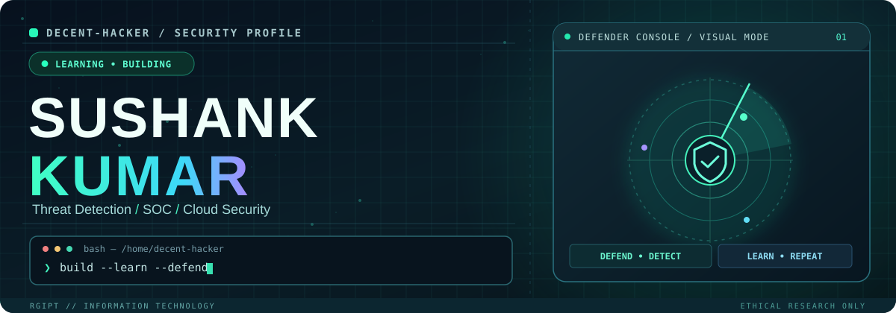
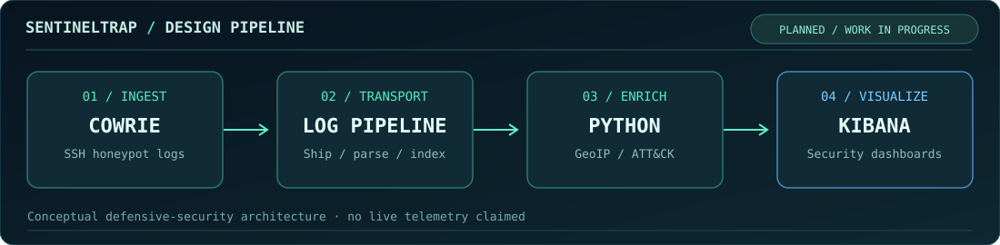

<!-- CUSTOM CYBER COMMAND CENTER / github.com/Decent-hacker -->
<div align="center">



<br />

<a href="https://github.com/Decent-hacker?tab=followers"></a>
<a href="https://github.com/Decent-hacker?tab=repositories"></a>


<br /><br />


</div>

```console
decent-hacker@security-lab:~$ whoami
Sushank Kumar  |  Information Technology @ RGIPT
Path            →  SOC / Threat Detection / Cloud Security
Mindset         →  Build · Break down · Investigate · Defend
Status          →  Learning in public, one lab at a time
```

<table>
<tr>
<td width="52%" valign="top">

### `01 / ABOUT THE OPERATOR`

I’m an IT undergraduate focused on **blue-team cybersecurity**: investigating events, understanding adversary behavior, and turning raw logs into useful security signals.

- 🛡️ **Areas of interest:** SOC, incident response, cloud security, threat intelligence
- 🧠 **Learning by doing:** Linux, networking, Python and detection workflows
- 🧪 **Current direction:** security labs, honeypot telemetry and log analysis
- 🔐 **Rule of engagement:** ethical research in authorized environments

</td>
<td width="48%" valign="top">

### `02 / MISSION BOARD`

| TRACK | FOCUS |
| :-- | :-- |
| `DETECT` | Analyze security logs |
| `INVESTIGATE` | Trace suspicious activity |
| `AUTOMATE` | Build Python tooling |
| `HARDEN` | Improve defensive posture |
| `DOCUMENT` | Publish reproducible labs |

**Now building:** practical skills and documented projects, not vanity metrics.

</td>
</tr>
</table>

### `03 / SECURITY TOOLKIT`

<div align="center">

**Operating Systems & Scripting**


**Network, Security & Monitoring**


**Development & Infrastructure**


<sub>Toolkit reflects technologies explored or used in projects, not claimed mastery or certifications.</sub>

</div>

### `04 / FEATURED SECURITY INITIATIVE`

<div align="center">

</div>

**SentinelTrap** `PLANNED / IN PROGRESS` — A cloud SSH honeypot and threat-intelligence project concept that explores the lifecycle from suspicious SSH attempts to structured logs, contextual enrichment, and security dashboards.

> This diagram is the **intended design**, not a claim of deployed infrastructure, real incidents or finished detection coverage. A public code repository and measured results will be linked when ready.

### `05 / ENGINEERING PROJECTS`

<table>
<tr>
<td width="50%" valign="top">

**[⚡ ReelForge AI](https://github.com/Decent-hacker/ReelForge-AI)**

Local AI-assisted video editing software under development. Includes documented tests and implementation status, with end-to-end media acceptance still incomplete.

`TypeScript` `Python` `SQLite`

</td>
<td width="50%" valign="top">

**[🧬 Bloom](https://github.com/Decent-hacker/Bloom)**

Classical computer-vision skin-image analysis, built around image processing rather than a trained diagnostic model.

`Python` `OpenCV` `DIP`

</td>
</tr>
<tr>
<td valign="top">

**[📈 Grid Load Forecast](https://github.com/Decent-hacker/Grid-load-forecast)**

Time-series engineering and next-hour power demand forecasting using real historical grid data.

`Python` `SQL` `ML`

</td>
<td valign="top">

**[🌐 Portfolio](https://github.com/Decent-hacker/portfolio)**

Personal security and engineering portfolio built with a clean, responsive web interface.

`Next.js` `React` `TypeScript`

</td>
</tr>
</table>

<div align="center">
<a href="https://github.com/Decent-hacker?tab=repositories"></a>
</div>

### `06 / LIVE DEVELOPMENT SIGNALS`

<div align="center">


</div>

<details>
<summary><b>▶ OPEN ADDITIONAL TELEMETRY · streaks, trophies & contributions</b></summary>
<br />
<div align="center">


**Contribution Snake**

<picture>
  <source media="(prefers-color-scheme: dark)" srcset="https://raw.githubusercontent.com/Decent-hacker/Decent-hacker/output/github-snake-dark.svg" />
  <source media="(prefers-color-scheme: light)" srcset="https://raw.githubusercontent.com/Decent-hacker/Decent-hacker/output/github-snake.svg" />
  
</picture>

</div>
</details>

---

<div align="center">

`ROOT ACCESS TO CURIOSITY. READ-ONLY ACCESS TO EVERYONE ELSE'S SYSTEMS.`

<sub>Cybersecurity exploration · ethical labs · documented engineering</sub>

<br /><br />

<a href="https://github.com/Decent-hacker"></a>

</div>
