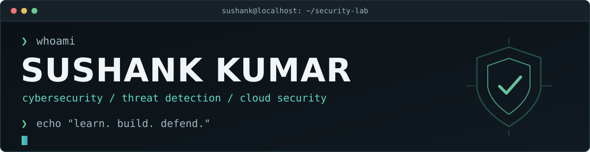

<!-- GitHub profile | hacker-style V2 | Decent-hacker -->

<div align="center">




<a href="https://github.com/Decent-hacker?tab=followers"></a>
<a href="https://github.com/Decent-hacker?tab=repositories"></a>


</div>

### `~/about`

```bash
$ whoami
Sushank Kumar
IT undergraduate @ RGIPT
Exploring SOC • Threat Detection • Cloud Security

$ cat current-focus.txt
Understanding security logs, investigating suspicious activity,
and building practical tools for defensive security.
```

I like working close to the technical details: Linux systems, network traffic, Python scripts, and the little clues that help explain what happened.

- **Currently learning:** security monitoring, incident response, threat intelligence, cloud security.
- **Interested in:** detection engineering, security automation, reproducible labs.
- **Building toward:** SentinelTrap, a planned cloud SSH honeypot and threat-intelligence platform. *Work in progress; no public repository yet.*
- **Approach:** document what actually works, own the limitations, and practice only in authorized environments.

### `~/toolbox`

<div align="center">


<br />


</div>

<sub>Some tools are part of my learning roadmap or experiments rather than claimed professional expertise.</sub>

### `~/projects`

| Repository | What I'm building / exploring |
| :-- | :-- |
| **[Bloom](https://github.com/Decent-hacker/Bloom)** | Classical computer-vision analysis with an explainable image-processing pipeline; not a trained diagnostic model. |
| **[Grid Load Forecast](https://github.com/Decent-hacker/Grid-load-forecast)** | Forecasting electricity demand from historical grid data with measurable baseline comparisons. |
| **[ReelForge AI](https://github.com/Decent-hacker/ReelForge-AI)** | Local AI-assisted video editor under development. End-to-end media acceptance remains incomplete. |
| **[Portfolio](https://github.com/Decent-hacker/portfolio)** | Next.js/React/TypeScript personal portfolio. |

<details>
<summary><b>↳ A security project I'm planning</b></summary>

**SentinelTrap:** The goal is to collect SSH honeypot telemetry, enrich suspicious events with contextual data, and explore useful detection dashboards. This describes a proposed project, not a finished or deployed system.

</details>

### `~/github-activity`

<div align="center">


</div>

### `~/contributions/snake` 🐍

<div align="center">

<picture>
  <source media="(prefers-color-scheme: dark)" srcset="https://raw.githubusercontent.com/Decent-hacker/Decent-hacker/output/github-snake-dark.svg" />
  <source media="(prefers-color-scheme: light)" srcset="https://raw.githubusercontent.com/Decent-hacker/Decent-hacker/output/github-snake.svg" />
  
</picture>

<sub>Generated from my real contribution graph by <a href="https://github.com/Platane/snk">Platane/snk</a>. Refreshed using a scheduled GitHub Actions workflow.</sub>

</div>

---

<div align="center">

`learning > pretending` · `documentation > buzzwords` · `authorized research only`

<a href="https://github.com/Decent-hacker?tab=repositories">Browse my repositories</a>

</div>
